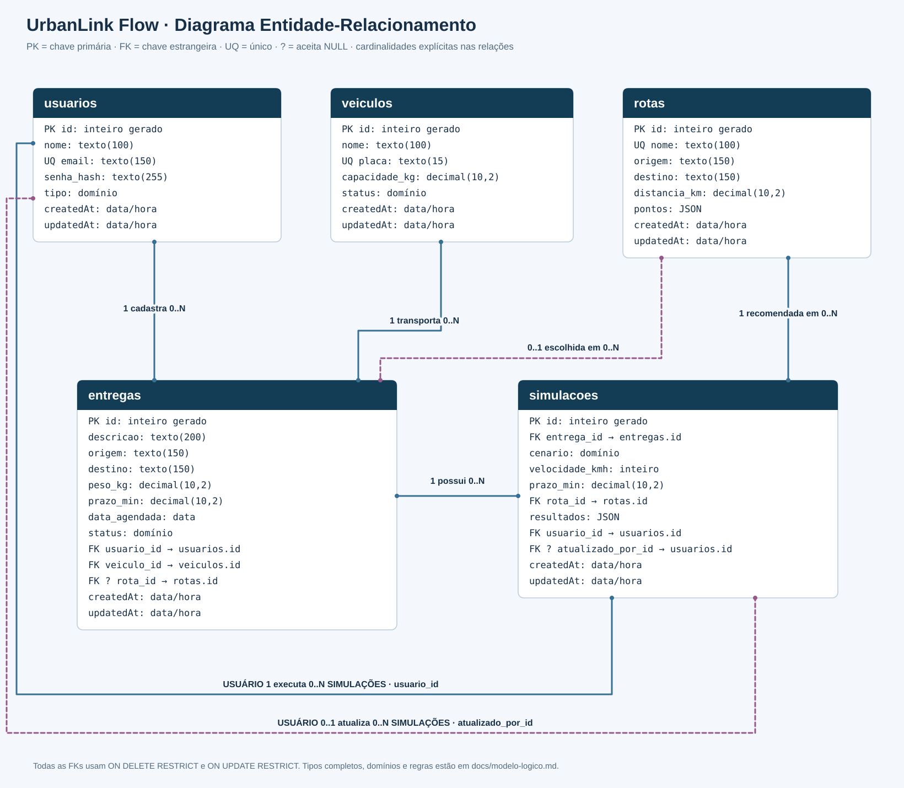

# UrbanLink Flow

Projeto final de Desenvolvimento de Sistemas: plataforma web simples para cadastrar entregas, comparar percursos e acompanhar uma operação logística. O back-end segue as aulas de Node.js, Express e Sequelize, com MySQL na demonstração local. A publicação gratuita no Render usa PostgreSQL, por solicitação do responsável pelo projeto. As páginas usam HTML, CSS e JavaScript puro.

## Links e arquivos da entrega

- **GitHub:** [Dopre-PNB/urbanlink-flow](https://github.com/Dopre-PNB/urbanlink-flow).
- **Endereço publicado:** [urbanlink-flow.onrender.com](https://urbanlink-flow.onrender.com).
- **Instalação, configuração e uso:** [guia completo](docs/instalacao-e-uso.md).
- **Banco de dados:** [modelo conceitual](docs/modelo-conceitual.md), [modelo lógico](docs/modelo-logico.md) e [DER](docs/der.md).
- **Arquivos adicionais:** [scripts SQL de criação/inserção e instruções](arquivos-adicionais/README.md).
- **Índice dos requisitos:** [conferência da entrega](docs/entrega.md).

## Objetivo do sistema

Centralizar os cadastros e o acompanhamento das entregas e apoiar a escolha de um percurso com base na distância, no cenário de circulação e no prazo informado. A simulação tem finalidade didática e permite comparar alternativas antes de vincular uma rota à entrega.

## Funcionalidades

- Login com e-mail/senha e permissões de administrador e operador.
- Cadastro e manutenção de usuários, veículos e rotas pelo administrador.
- Criação e edição de entregas com origem, destino, peso, prazo, data e veículo.
- Busca, paginação e filtros por status e data.
- Atualização do estado da entrega, com controle da capacidade e disponibilidade do veículo.
- Comparação de rotas alternativas nos cenários normal e lento, recomendação e conferência do prazo.
- Registro, consulta, recálculo e exclusão de simulações com autoria e histórico dos resultados.
- Visualização ilustrativa de percursos em mapa e painel de indicadores.
- Documentação interativa da API com Swagger/OpenAPI.

## Tecnologias utilizadas

| Camada                     | Tecnologias                                               |
| -------------------------- | --------------------------------------------------------- |
| Interface                  | HTML5, CSS3, JavaScript, Inter e Lenis servido localmente |
| Mapa                       | Leaflet e OpenStreetMap                                   |
| Servidor/API               | Node.js 22 a 24, Express 5 e Sequelize 6                  |
| Persistência               | MySQL 8 local e PostgreSQL na hospedagem                  |
| Autenticação               | JSON Web Token (JWT) e bcrypt                             |
| Documentação               | Markdown, diagramas Mermaid/SVG e OpenAPI 3/Swagger UI    |
| Verificação                | Node Test Runner, Playwright e Prettier                   |
| Versionamento e publicação | Git, GitHub e Render; configuração em `render.yaml`       |

As versões exatas das dependências ficam em [package-lock.json](package-lock.json).

## Publicar no GitHub e no Render

O endereço configurado é [urbanlink-flow.onrender.com](https://urbanlink-flow.onrender.com), com site/API e PostgreSQL no próprio Render, ambos no plano Free. A última verificação completa registrada da hospedagem é de 08/10/2026. **Na conferência de 18/11/2026, o endereço apresentou a tela de inicialização do Render e a API não respondeu dentro de 25 segundos; o funcionamento público ainda precisa ser restabelecido e validado.** O banco gratuito original tinha expiração prevista para 07/11/2026. O requisito de site funcionando continua pendente até a nova validação.

O código está no [GitHub](https://github.com/Dopre-PNB/urbanlink-flow). O arquivo `render.yaml` e o [passo a passo de publicação](docs/publicacao-github-render.md) registram a configuração. Em produção, o primeiro administrador usa credenciais privadas configuradas no Render e as contas de demonstração não são criadas. O responsável deve fornecer acesso ao avaliador por um canal privado para permitir os testes das funções protegidas.

O site gratuito hiberna após 15 minutos sem acesso. O PostgreSQL gratuito expira após 30 dias; essa validade é independente da hibernação do site. Nenhuma conversão para plano pago faz parte desta configuração. Veja as [limitações oficiais do Render Free](https://render.com/docs/free).

## Começar no Windows

Requisitos: Node.js 22 a 24 e MySQL 8 ou superior. No PowerShell, entre nesta pasta e execute:

```powershell
npm.cmd ci
```

A forma mais simples de apresentar usando a instância dedicada é:

```powershell
npm.cmd run demo
```

Esse comando prepara o MySQL local na porta 3307, cria `.env` quando ele não existe, executa o setup e mantém banco e servidor ativos no mesmo terminal. Mantenha esse terminal aberto enquanto usa a plataforma. Se já configurou `.env` para um banco próprio, use a instalação manual abaixo. O comando preserva configurações existentes.

Também é possível executar as etapas separadamente:

**MySQL já instalado:** copie a configuração de exemplo e edite `.env` com endereço, porta, usuário e senha de uma conta que possa criar o banco `urbanlink_flow`. Depois:

```powershell
if (-not (Test-Path -LiteralPath '.env')) { Copy-Item -LiteralPath '.env.example' -Destination '.env' }
npm.cmd run db:setup
npm.cmd start
```

**Instância local isolada para este projeto:** execute:

```powershell
npm.cmd run db:local
npm.cmd run db:setup
npm.cmd start
```

O comando `db:local` prepara uma instância MySQL dedicada ao projeto na porta 3307, cria `.env` automaticamente se não existir e preserva seus dados entre execuções. Use essa opção antes de copiar o exemplo de configuração: o comando preserva um `.env` existente e recusa sobrescrevê-lo. Procura por padrão `C:\Program Files\MySQL\MySQL Server 8.0\bin\mysqld.exe`; se o MySQL estiver em outro local, defina `$env:MYSQLD_PATH` com o caminho do executável. Para encerrar essa instância depois de fechar a aplicação: `npm.cmd run db:stop`.

Abra [http://localhost:3000](http://localhost:3000). A documentação interativa da API está em [http://localhost:3000/api/docs](http://localhost:3000/api/docs); a especificação está em [http://localhost:3000/api/openapi.json](http://localhost:3000/api/openapi.json). `db:setup` executa o script físico do banco e cria dados de demonstração de forma idempotente; não apaga o banco existente.

## Contas de demonstração

| Perfil        | E-mail                   | Senha        |
| ------------- | ------------------------ | ------------ |
| Administrador | admin@urbanlink.local    | Admin@123    |
| Operador      | operador@urbanlink.local | Operador@123 |

Estas credenciais são destinadas à apresentação local. O administrador cadastra outros usuários. Não há cadastro público. Os dois perfis usam a mesma tela de login; o servidor determina as permissões pelo perfil registrado no banco.

O administrador gerencia usuários, veículos e rotas e pode excluir registros. O operador consulta dados, cria e atualiza entregas e executa simulações. O sistema bloqueia exclusões que quebrariam relacionamentos. Senhas são armazenadas como hashes bcrypt e não aparecem nos retornos da API.

## Como demonstrar

1. Entre como operador e abra Entregas.
2. Selecione a entrega demonstrativa de 100 kg, do Centro de Distribuição ao Mercado Central, com prazo de 20 minutos.
3. Simule circulação normal: Via Central, de 8 km, leva 16 minutos; Via Parque, de 12 km, leva 24 minutos. A Via Central é recomendada e atende ao prazo.
4. Troque para circulação lenta: os tempos passam a 24 e 36 minutos. A recomendação continua sendo Via Central, mas o prazo é ultrapassado.
5. Salve a simulação e confirme a rota para a entrega. Atualize o status para em andamento e depois concluída.
6. Confira os indicadores no Painel. Entre como administrador para demonstrar os cadastros e a diferença de permissões.

Veja o roteiro completo em [docs/roteiro-apresentacao.md](docs/roteiro-apresentacao.md).

## Páginas

| Página           | Finalidade                                                  |
| ---------------- | ----------------------------------------------------------- |
| `index.html`     | Apresentação com vídeos de logística e acesso à plataforma. |
| `login.html`     | Entrada única para administrador e operador.                |
| `painel.html`    | Indicadores e últimas entregas.                             |
| `entregas.html`  | Cadastro, busca, filtro por status/data e acompanhamento.   |
| `simulacao.html` | Comparação de percursos, cenários, histórico e mapa.        |
| `cadastros.html` | Abas de veículos, rotas e usuários, para administrador.     |

Agenda corresponde ao filtro por data em Entregas. Mapa é uma seção de Simulação. O menu mantém as referências do design sem acrescentar outras páginas.

## Simulação e limites

As distâncias são estimativas cadastradas para duas alternativas que têm a mesma origem e o mesmo destino. A previsão usa `tempo em minutos = distância em km / velocidade em km/h × 60`: 30 km/h no cenário normal e 20 km/h no lento. Recomenda-se o menor tempo; em caso de igualdade, vence a rota de menor ID. A igualdade com o prazo conta como dentro do prazo.

Os pontos no mapa ilustram o percurso cadastrado. A aplicação não calcula distâncias viárias, GPS ou tráfego ao vivo. O mapa-base do OpenStreetMap depende de internet. Cadastros e cálculos usam a API e um banco relacional: MySQL na demonstração local e PostgreSQL na publicação gratuita do Render. O monitoramento resulta da atualização de status pelo operador. O Painel consulta a API a cada 30 segundos, pausando a consulta quando a aba fica oculta. A média de tempo e o percentual dentro do prazo vêm da última simulação de cada entrega, não da duração real da viagem.

## Estrutura e documentação

```text
arquivos-adicionais/      instruções e entradas SQL para criação/inserção
database/schema.sql       modelo físico MySQL, PK, FK e índices
database/schema-postgres.sql modelo físico PostgreSQL para o Render
database/seed.sql         dados demonstrativos em SQL MySQL
database/seed-postgres.sql dados demonstrativos em SQL PostgreSQL
docs/                     requisitos, modelos, OpenAPI, testes e apresentação
docs/diagramas/           diagramas visuais e fontes editáveis
public/                   seis páginas, CSS, JavaScript e imagens
scripts/                  configuração MySQL local, setup e dados iniciais
src/config/               ambiente e conexão Sequelize
src/models/               entidades e relacionamentos
src/services/             regras de negócio e transações
src/controllers/          entrada/saída HTTP
src/routes/               endpoints REST
src/middlewares/          autenticação, autorização e erros
src/app.js                inicialização do Express
tests/                    testes automatizados da API e da interface
```

Documentos principais:

- [Requisitos e regras](docs/requisitos.md)
- [Modelo conceitual](docs/modelo-conceitual.md)
- [Modelo lógico](docs/modelo-logico.md)
- [Diagrama Entidade-Relacionamento (DER)](docs/der.md)
- [Instalação e uso](docs/instalacao-e-uso.md)
- [Arquivos adicionais e scripts SQL](arquivos-adicionais/README.md)
- [Índice da entrega](docs/entrega.md)
- [Matriz de rastreabilidade](docs/matriz-rastreabilidade.md)
- [Plano e casos de teste](docs/plano-de-testes.md)
- [OpenAPI 3](docs/openapi.json)
- [Referências e decisões de escopo](docs/fontes-e-escopo.md)
- [Publicação no GitHub e no Render](docs/publicacao-github-render.md)

Os modelos físicos estão em [database/schema.sql](database/schema.sql), para MySQL, e [database/schema-postgres.sql](database/schema-postgres.sql), para PostgreSQL. A variável `DATABASE_URL` seleciona PostgreSQL; sem ela, a aplicação usa a configuração MySQL `DB_*`. Os dois bancos usam as mesmas cinco entidades e regras da plataforma. A API segue `/api` e retorna `{ dados }` nas consultas individuais; as listas retornam `{ dados, total, pagina, limite }`. Utilize o token de login no cabeçalho `Authorization: Bearer ...`.

## Modelagem do banco de dados



| Entidade     | Finalidade e vínculos                                                                                    |
| ------------ | -------------------------------------------------------------------------------------------------------- |
| `usuarios`   | Acesso e perfil; identifica o autor da entrega e o autor/editor das simulações.                          |
| `veiculos`   | Placa, capacidade e estado; pode atender várias entregas ao longo do tempo.                              |
| `rotas`      | Origem, destino, distância e pontos; pode ser vinculada a entregas e recomendada em simulações.          |
| `entregas`   | Carga, prazo, data e estado; exige usuário e veículo, e admite rota ainda não definida.                  |
| `simulacoes` | Resultado e retrato das alternativas; pertence a uma entrega, rota recomendada e autor; editor opcional. |

Os sete relacionamentos são 1:N. `entregas.rota_id` e `simulacoes.atualizado_por_id` são opcionais; os demais vínculos são obrigatórios. Cada tabela tem chave primária `id`. Os [modelos na pasta de documentação](docs/der.md) detalham cardinalidades, atributos, chaves e restrições. Os [scripts SQL adicionais](arquivos-adicionais/README.md) indicam a ordem de criação do banco/tabelas e inserção dos dados.

## Verificação

Com banco preparado e servidor ativo, em outro terminal:

```powershell
npm.cmd test
npm.cmd run test:ui
```

Os testes de API usam as contas demonstrativas por padrão, criam registros exclusivos com prefixo de teste e limpam somente os IDs que criaram. Para um ambiente de teste com contas próprias, configure `TEST_ADMIN_EMAIL`, `TEST_ADMIN_PASSWORD`, `TEST_OPERATOR_EMAIL` e `TEST_OPERATOR_PASSWORD` sem registrar as senhas no repositório. Se a aplicação usar outra porta, configure antes `$env:TEST_BASE_URL = 'http://127.0.0.1:3001'`. A verificação da interface usa o Google Chrome instalado; como alternativa, instale o Chromium com `npx.cmd playwright install chromium`. As capturas de tela e o relatório ficam em `output/verificacao/`.

Resultados executados e limitações da verificação devem ser registrados em [docs/resultados-testes.md](docs/resultados-testes.md). Alterações significativas devem receber commits descritivos no Git. `.env`, dependências, dados privados e arquivos de execução local não entram no repositório.
