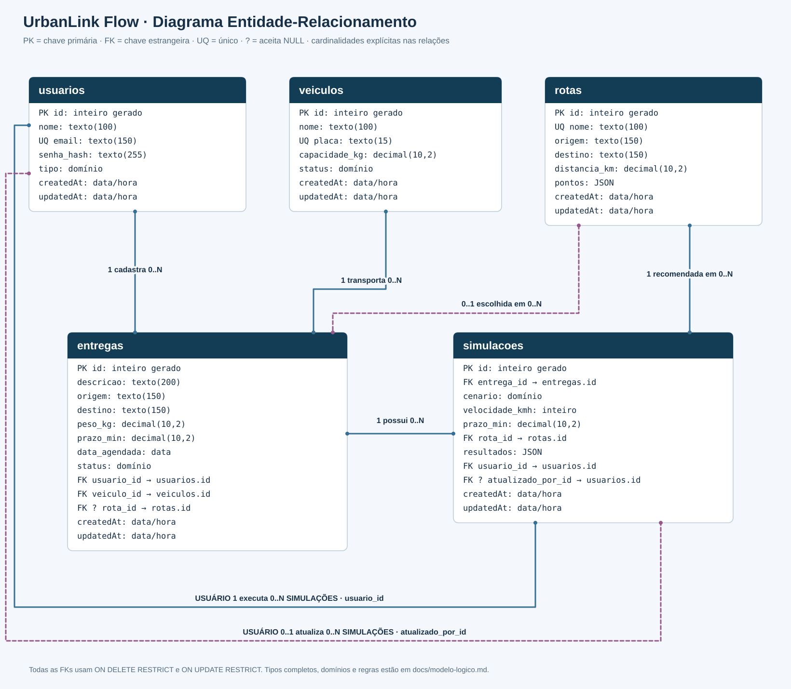
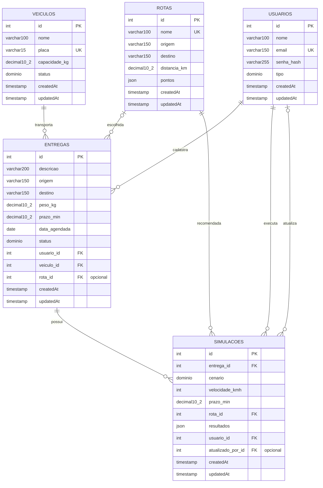

# Diagrama Entidade-Relacionamento (DER)

Este DER representa a estrutura implementada do UrbanLink Flow: cinco tabelas, suas chaves e sete relacionamentos. Confira o [modelo conceitual](modelo-conceitual.md) para a visão do domínio e o [modelo lógico](modelo-logico.md) para tipos, nulabilidade e regras de cada atributo.

Arquivo para apresentação: [der.svg](diagramas/der.svg). O SVG é vetorial e pode ser ampliado sem perder definição. A versão Mermaid editável está abaixo.

## Legenda

- `PK`: chave primária; `FK`: chave estrangeira; `UK` / `UQ`: valor único.
- `||`: exatamente um; `o|`: zero ou um; `o{`: zero ou muitos.
- Os dois campos opcionais são `entregas.rota_id` e `simulacoes.atualizado_por_id`.
- Todas as relações usam `ON DELETE RESTRICT` e `ON UPDATE RESTRICT`.

Os tipos do diagrama são abreviações de documentação. Os tipos executáveis estão nos scripts [MySQL](../database/schema.sql) e [PostgreSQL](../database/schema-postgres.sql). Em Entregas, `rota_id` é a escolha operacional; em Simulações, é a recomendação calculada. A recomendação não altera automaticamente a rota da entrega: o operador confirma a escolha na aplicação.
