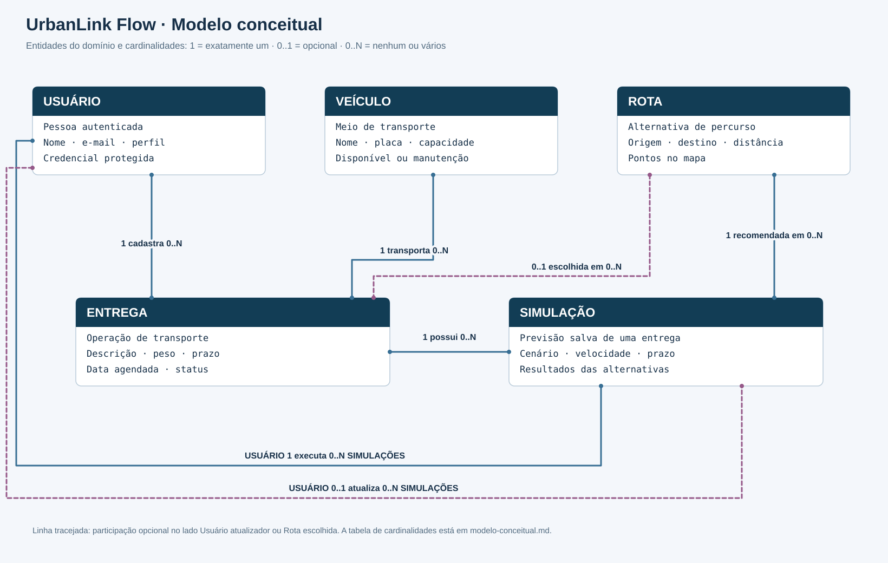
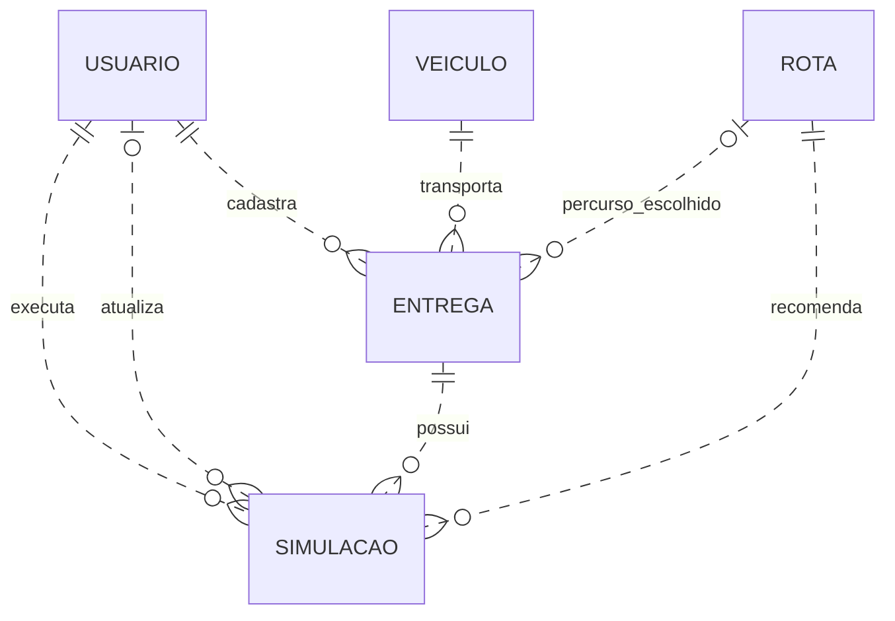

# Modelo conceitual — UrbanLink Flow

O sistema acompanha entregas urbanas e compara percursos estimados. O domínio tem cinco entidades: Usuário, Veículo, Rota, Entrega e Simulação. Este modelo descreve seus significados e relacionamentos sem depender de um gerenciador de banco específico.

O [SVG](diagramas/modelo-conceitual.svg) pode ser aberto no navegador ou inserido na apresentação. A representação Mermaid mantém o diagrama editável no próprio documento.

## Entidades e atributos de negócio

| Entidade  | Significado                                              | Atributos de negócio                                                                                 |
| --------- | -------------------------------------------------------- | ---------------------------------------------------------------------------------------------------- |
| Usuário   | Pessoa autenticada com perfil administrador ou operador. | Nome, e-mail, credencial protegida e perfil.                                                         |
| Veículo   | Meio de transporte cadastrado na operação.               | Nome, placa, capacidade em kg e estado disponível/manutenção.                                        |
| Rota      | Alternativa de percurso entre uma origem e um destino.   | Nome, origem, destino, distância estimada em km e pontos do mapa.                                    |
| Entrega   | Operação de transporte de uma carga agendada.            | Descrição, origem, destino, peso, prazo em minutos, data agendada e estado.                          |
| Simulação | Previsão salva para uma entrega em determinado cenário.  | Cenário, velocidade, prazo considerado, resultados das alternativas e datas de registro/atualização. |

## Relacionamentos e cardinalidades

`1` significa exatamente um; `0..1`, nenhum ou um; `0..N`, nenhum ou vários.

| Relacionamento                  | A partir da primeira entidade                        | A partir da segunda entidade                                        |
| ------------------------------- | ---------------------------------------------------- | ------------------------------------------------------------------- |
| Usuário cadastra Entrega        | Um usuário cadastra `0..N` entregas.                 | Cada entrega tem `1` usuário autor.                                 |
| Veículo transporta Entrega      | Um veículo atende `0..N` entregas ao longo do tempo. | Cada entrega utiliza `1` veículo.                                   |
| Rota é escolhida para Entrega   | Uma rota é escolhida para `0..N` entregas.           | Cada entrega possui `0..1` rota escolhida.                          |
| Entrega possui Simulação        | Uma entrega possui `0..N` simulações salvas.         | Cada simulação pertence a `1` entrega.                              |
| Rota é recomendada em Simulação | Uma rota é recomendada em `0..N` simulações.         | Cada simulação salva tem `1` rota recomendada.                      |
| Usuário executa Simulação       | Um usuário executa `0..N` simulações.                | Cada simulação tem `1` usuário autor.                               |
| Usuário atualiza Simulação      | Um usuário atualiza `0..N` simulações.               | Cada simulação registra `0..1` último responsável pela atualização. |

Os dois relacionamentos entre Usuário e Simulação representam papéis diferentes: autor original e último atualizador. Uma simulação recém-criada pode não ter atualizador; ela sempre tem autor. O banco guarda o último atualizador, sem uma tabela de versões de todas as edições.

## Regras do domínio

- Uma entrega pode aguardar a escolha de rota; para entrar em andamento, precisa ter uma rota definida.
- Um veículo pode atender várias entregas no histórico, mas somente uma entrega em andamento por vez. A aplicação controla esse limite em uma transação.
- Entregas pendentes ou em andamento exigem veículo disponível e capacidade suficiente para o peso informado.
- A rota escolhida deve ter a mesma origem e o mesmo destino da entrega. As alternativas de uma simulação também devem corresponder a esse trajeto.
- O cenário normal usa 30 km/h; o lento usa 20 km/h. Recomenda-se o menor tempo estimado; em empate, a rota de menor identificador.
- A simulação conserva um retrato dos resultados calculados. Uma edição da simulação recalcula e substitui esse retrato; editar somente o cadastro da rota não altera a previsão salva.
- Registros referenciados não são excluídos em cascata. Os vínculos preservam a integridade dos dados.

Mapa, agenda e indicadores são visualizações dessas entidades; não criam outras tabelas. O mapa representa pontos cadastrados e não constitui rastreamento por GPS.

Continue em [modelo lógico](modelo-logico.md), [DER com atributos](der.md) e scripts físicos [MySQL](../arquivos-adicionais/sql/mysql/01-criar-banco-e-tabelas.sql) / [PostgreSQL](../arquivos-adicionais/sql/postgresql/01-criar-tabelas.sql).
